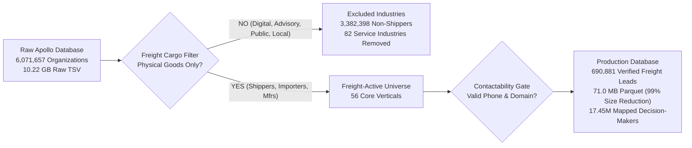

# Jet Freight Logistics — B2B Lead Database: Industry Selection & Strategy Guide

**Target Audience:** Executive Leadership, Head of Sales, and Commercial Strategy  
**Document Version:** 1.0  
**Date:** October 2026  
**Dataset Reference:** Apollo Organization & Contact Database (`apollo_freight_leads.parquet`)  
**Project:** Jet Freight Logistics — Automated Lead Sourcing Engine  

---

## 1. Executive Summary: Why We Filtered Industries

A common pitfall in B2B lead generation is measuring database quality by raw volume rather than commercial relevance. 

The raw Apollo database contained **6,071,657 raw organizations** across 180 industry tags. However, **more than 55% of those companies have zero requirement for international air cargo, ocean shipping, or customs clearance** (for example: software vendors, local accounting firms, law offices, and yoga studios). 

If left unfiltered, sales representatives would waste hundreds of hours calling businesses with no physical supply chain, resulting in poor conversion rates, rep fatigue, and wasted marketing spend.

### Core Strategy: Freight-Active Shippers Only

Jet Freight Logistics is an international freight forwarder delivering:
1. **Air Freight:** Time-critical, AOG (Aircraft On Ground), cold-chain pharma, perishable cargo, high-value electronics.
2. **Ocean Freight (FCL & LCL):** High-volume container shipping, breakbulk, project cargo, refrigerated containers (Reefer).
3. **Customs Brokerage (CHA):** Cross-border documentation, tariff classification, compliance, and bonded transfers.
4. **Contract Logistics & 3PL:** Value-added warehousing, consolidation, and local drayage.

To support this revenue model, **we applied a strict freight domain filter**: only businesses that **manufacture, assemble, import, export, or distribute physical, tangible cargo** were retained. Every pure service, advisory, digital, or local brick-and-mortar organization was eliminated.

---

## 2. Quantitative Impact & Pipeline Scorecard

| Metric | Raw Apollo Export | Final Production Database | Strategic Benefit |
| :--- | :---: | :---: | :--- |
| **Total Companies** | 6,071,657 | **690,881** | 100% focused on commercial shippers; zero wasted outbound calls. |
| **Industry Tags** | 180 Categories | **56 Verticals** | Exclusively physical cargo producers, importers, and exporters. |
| **Phone Contactability** | ~60% | **100.0%** | Every company has a validated, direct phone number. |
| **Storage & Performance** | 10.22 GB TSV | **71.0 MB Parquet** | 99.3% compression; sub-second query performance in CRM/analytics. |
| **Mapped Decision-Makers** | Unlinked raw dump | **17,457,110 Contacts** | Direct access to 766k logistics managers and 5.5M executive CXOs. |

---

## 3. Retained Industries: 56 Freight-Active Verticals

The 56 kept industries represent **690,881 qualified companies** categorized into **7 strategic commercial freight clusters**. Every vertical has an immediate, proven freight-forwarding use case for Jet Freight Logistics.

### Cluster 1: Heavy Engineering, Industrial & Construction (194,545 Companies)
*High-tonnage ocean containers, flat-racks, open-tops, breakbulk, and project cargo.*

| Industry Name | Verified Leads | Primary Freight Modes | Commercial Use Case for Jet Freight Logistics |
| :--- | :---: | :--- | :--- |
| `construction` | 91,760 | Ocean FCL / Project Cargo | Heavy structural materials, prefabricated units, stone, tiles, earthmoving equipment. |
| `mechanical or industrial engineering` | 25,954 | Ocean FCL / Air Spares | Industrial machinery, hydraulic systems, plant tooling, precision production equipment. |
| `machinery` | 19,367 | Ocean Flat-Rack / Breakbulk | Machine tools, heavy packaging machinery, textile equipment, industrial robotics. |
| `building materials` | 15,199 | Heavy Ocean FCL | Lumber, architectural glass, sanitaryware, structural steel, ceramic slabs. |
| `civil engineering` | 13,115 | Heavy Project Cargo | Bridge steel, tunneling infrastructure, heavy piping, port construction hardware. |
| `industrial automation` | 9,708 | Air Cargo & Ocean FCL | PLCs, robotic arms, sensor assemblies, automated warehouse conveyance systems. |
| `business supplies & equipment` | 9,794 | Ocean FCL / LCL | Commercial office equipment, industrial hardware, point-of-sale terminals. |
| `glass, ceramics & concrete` | 1,986 | Ocean FCL (Fragile Heavy) | Architectural glass panels, porcelain fixtures, pre-cast concrete modules. |
| `manufacturing` | 618 | Multi-Modal Ocean / Air | Discrete industrial manufacturing facilities producing finished engineered products. |

---

### Cluster 2: Automotive, Aerospace & Defense (59,824 Companies)
*High-yield, time-critical air cargo, emergency AOG, and automotive supply chains.*

| Industry Name | Verified Leads | Primary Freight Modes | Commercial Use Case for Jet Freight Logistics |
| :--- | :---: | :--- | :--- |
| `automotive` | 39,850 | Air Freight (AOG) & Ocean FCL | OEM spare parts, CKD/SKD kits, tires, engines, urgent assembly line-down air freight. |
| `aviation & aerospace` | 6,237 | High-Security Air Cargo | Aerostructures, composite panels, avionics, flight-test components, satellite modules. |
| `airlines/aviation` | 6,000 | Emergency AOG Air Freight | Aircraft engines, landing gear, critical avionics under Aircraft On Ground (AOG) status. |
| `defense & space` | 3,737 | Secure Air & Project Ocean | Defense electronics, tactical hardware, radar units, ITAR-compliant controlled cargo. |

---

### Cluster 3: Pharmaceuticals, Life Sciences & Healthcare (31,667 Companies)
*Temperature-controlled, GDP-compliant, high-margin cold-chain air freight and refrigerated ocean cargo.*

| Industry Name | Verified Leads | Primary Freight Modes | Commercial Use Case for Jet Freight Logistics |
| :--- | :---: | :--- | :--- |
| `medical devices` | 12,840 | High-Value Air Cargo | Surgical implants, diagnostic ultrasound/MRI equipment, patient monitoring devices. |
| `pharmaceuticals` | 10,187 | Cold-Chain Air (+2°C to +8°C / +15°C to +25°C) | Active Pharmaceutical Ingredients (APIs), finished formulations, vaccines, clinical trials. |
| `biotechnology` | 8,640 | Deep Frozen / Cryogenic Air (-20°C to -80°C) | Cell cultures, biological reagents, gene therapies requiring dry-ice or liquid nitrogen shippings. |

---

### Cluster 4: High-Tech, Electronics & Telecommunications (60,959 Companies)
*High-value, shock-sensitive air cargo and rapid-cycle ocean freight.*

| Industry Name | Verified Leads | Primary Freight Modes | Commercial Use Case for Jet Freight Logistics |
| :--- | :---: | :--- | :--- |
| `telecommunications` | 24,220 | Air Cargo & Ocean FCL | 5G cellular base stations, satellite dishes, fiber optic cables, switching hardware. |
| `electrical/electronic manufacturing` | 23,243 | Air Freight & Ocean FCL | Transformers, switchgears, circuit boards, power supplies, electric motors. |
| `consumer electronics` | 6,472 | Secured Air Freight | Smartphones, audio equipment, tablets, smart home hardware, personal wearables. |
| `computer hardware` | 4,556 | Air Freight & Ocean FCL | Enterprise server racks, data center storage arrays, networking switches. |
| `semiconductors` | 2,468 | Shock & Climate Monitored Air | Silicon wafers, integrated circuits (ICs), semiconductor fab manufacturing tools. |
| `nanotechnology` | 826 | Precision Air Cargo | Nanomaterials, carbon nanotubes, lab-scale specialized fabrication equipment. |

---

### Cluster 5: Food, Perishables, Agriculture & Cold-Chain (55,047 Companies)
*Reefer containers, temperature-controlled air freight, and agricultural commodity flows.*

| Industry Name | Verified Leads | Primary Freight Modes | Commercial Use Case for Jet Freight Logistics |
| :--- | :---: | :--- | :--- |
| `food & beverages` | 28,274 | Reefer Ocean & Air Freight | Specialty food products, processed beverages, frozen items, imported gourmet ingredients. |
| `food production` | 11,272 | Reefer Ocean & Cold-Chain Air | Meat processing, seafood exports, processed dairy, IQF frozen fruits/vegetables. |
| `farming` | 6,658 | Bulk Ocean & Air Perishables | Fresh produce, exotic fruits, grains, pulses, seeds requiring phytosanitary clearance. |
| `wine & spirits` | 6,066 | Temperature-Controlled Ocean / Air | High-value vintage wines, premium spirits, bonded warehousing, excise customs clearance. |
| `dairy` | 959 | Reefer Ocean & Air Cargo | Butter, cheese, powdered milk, infant formula requiring uninterrupted cold-chain. |
| `ranching` | 778 | Live Animal Air & Cold Ocean | Livestock transport, breeding cattle air cargo, leather and hide export containers. |
| `fishery` | 757 | Fresh Air Perishables & Reefer Ocean | Fresh tuna, salmon, frozen shrimp, live crab exports with strict transit deadlines. |
| `supermarkets` | 649 | Reefer Ocean & Air Perishables | Large retail supermarket chains importing international food, produce, and consumer goods. |
| `tobacco` | 507 | Dry Ocean Containers (FCL) | Processed tobacco leaf, raw tobacco bales, packaged consumer tobacco products. |
| `agriculture` | 18 | Bulk Ocean Freight | Agricultural commodities, fertilizers, bulk crop shipments. |

---

### Cluster 6: Consumer Goods, Fashion, Retail & Lifestyle (94,769 Companies)
*High-volume ocean container distribution, seasonal air replenishment, and e-commerce fulfillment.*

| Industry Name | Verified Leads | Primary Freight Modes | Commercial Use Case for Jet Freight Logistics |
| :--- | :---: | :--- | :--- |
| `retail` | 35,864 | Ocean FCL/LCL & Air Replenish | Retail chains importing inventory from Asia/Europe; cross-border distribution. |
| `apparel & fashion` | 16,112 | Garments on Hangers (GOH) Air / Ocean | Seasonal fashion collections, hanging garments, footwear, fashion accessories. |
| `consumer goods` | 15,652 | Ocean FCL / LCL | High-volume household merchandise, kitchenware, personal appliances, FMCG. |
| `furniture` | 10,876 | High-Cube Ocean (40ft HC) | Commercial furniture, modular office systems, flat-pack wooden goods, home decor. |
| `cosmetics` | 7,228 | Temp-Controlled Air / Ocean (DG Class 3) | Skincare creams, makeup, perfumes (Dangerous Goods - Flammable liquids). |
| `packaging & containers` | 6,067 | Ocean FCL | Corrugated boxes, industrial drums, plastic bottles, packaging films. |
| `sporting goods` | 5,964 | Ocean FCL / LCL | Fitness machinery, bicycles, sports gear, outdoor camping equipment. |
| `textiles` | 5,901 | Ocean FCL / Air Samples | Raw cotton bales, woven yarn, synthetic fabrics, industrial textiles. |
| `luxury goods & jewelry` | 4,954 | Secured Valuable Air Cargo (VAL) | High-value jewelry, fine diamonds, luxury timepieces requiring armored escort. |

---

### Cluster 7: Energy, Chemicals, Mining & Logistics Intermediaries (94,075 Companies)
*Heavy project cargo, Dangerous Goods (IMO/DG), customs brokerage, and 3PL partnerships.*

| Industry Name | Verified Leads | Primary Freight Modes | Commercial Use Case for Jet Freight Logistics |
| :--- | :---: | :--- | :--- |
| `environmental services & clean energy` | 33,015 | Ocean Breakbulk & Air Freight | Solar panels, wind turbine blades/gearboxes, battery storage, clean-tech recycling units. |
| `oil & energy` | 22,509 | Heavy Ocean Project Cargo | Drilling tools, valves, subsea pipes, refinery modules, hazardous petrochemicals. |
| `events services` | 21,990 | Air Freight / ATA Carnet | Exhibition logistics, booth setups, event stage gear, international trade show cargo. |
| `transportation` | 19,346 | Domestic Drayage / Co-loading | Regional linehaulers, trucking companies, drayage partners for multi-modal logistics. |
| `wholesale` | 15,719 | Ocean FCL/LCL & Customs CHA | General trading wholesalers, distributors requiring customs brokerage and warehousing. |
| `printing` | 14,646 | Ocean FCL & Air Machinery Spares | Heavy paper rolls, commercial printing presses, ink drums, packaging cartons. |
| `logistics & supply chain` | 12,407 | Co-loading / 3PL Partnering | Overseas regional forwarders and 3PLs seeking Indian/US origin-destination handling. |
| `chemicals` | 8,814 | Dangerous Goods (DG Ocean & Air) | Industrial specialty chemicals, resins, solvents, hazardous materials compliance. |
| `mining & metals` | 8,184 | Bulk Ocean & Breakbulk | Metal ingots, aluminum coils, steel sheets, heavy mining excavators and drill bits. |
| `maritime` | 7,644 | Ship Spares / Marine Logistics | Marine propulsion spares, vessel provisioning, offshore supply base logistics. |
| `plastics` | 6,012 | Ocean FCL (Resins & Polymers) | Polymer granules, plastic injection-molded components, raw polymer resin bags. |
| `import & export` | 5,396 | Multi-Modal Air & Ocean + CHA | Pure import-export trading companies seeking full-scope freight and customs clearance. |
| `international trade & development` | 5,341 | Multi-Modal Air & Ocean + CHA | Cross-border trade intermediaries and global commercial distributors. |
| `warehousing` | 2,301 | CFS & Bonded Cross-docking | Container freight stations (CFS), bonded warehouses, cross-dock logistics facilities. |
| `paper & forest products` | 2,043 | Heavy Ocean FCL | Pulp rolls, timber, corrugated kraft paper, commercial paper reels. |

---

## 4. Excluded Industries: 82 Non-Freight Verticals (~3.38 Million Records)

A total of **3,382,398 organizations** across 82 industry categories were removed. These entities represent pure services, intellectual property, financial transactions, or localized operations with **zero requirement for commercial freight forwarding**.

### Group A: Digital, Software & SaaS (840,000+ Companies)
*Deliverables are transmitted digitally over fiber and cloud infrastructure with 0 kg of physical cargo.*

| Excluded Industry | Raw Count | Rationale for Exclusion |
| :--- | :---: | :--- |
| `information technology & services` | 361,208 | IT consulting, system integration, cloud hosting, software support. No physical goods. |
| `computer software` | 132,149 | B2B SaaS, mobile applications, enterprise software codebases. Zero freight needs. |
| `internet` | 116,970 | Web portals, online platforms, digital publishers. No physical cargo. |
| `graphic design` | 33,750 | Digital graphics, brand design, UI/UX asset creation. Delivered via cloud. |
| `online media` | 17,084 | Digital blogs, web newsletters, streaming platforms. Zero physical distribution. |
| `computer & network security` | 13,539 | Cybersecurity SaaS, penetration testing, compliance auditing. Zero shipping. |
| `computer games` | 11,664 | Video game developers; digital downloads via Steam/App Stores. |
| `computer networking` | 10,207 | Network architecture design and IT support services. |
| `animation` | 5,097 | Digital rendering, visual effects (VFX), CGI studio files. |

---

### Group B: Financial Services, Banking & Capital Markets (325,000+ Companies)
*Transactions consist of monetary capital, credit underwriting, and electronic wire transfers.*

| Excluded Industry | Raw Count | Rationale for Exclusion |
| :--- | :---: | :--- |
| `finance` | 124,664 | Corporate financial advisory, wealth management, mortgage broking. No cargo. |
| `accounting` | 62,731 | Tax preparation, statutory audit, bookkeeping, payroll services. No physical shipping. |
| `insurance` | 56,767 | Life, health, commercial liability policies. Pure legal risk underwriting. |
| `investment management` | 23,332 | Portfolio management, equity funds, asset allocation. |
| `banking` | 19,605 | Retail and commercial banking branches, loan origination. |
| `venture capital & private equity`| 12,397 | Investment partnerships and buyout funds. No supply chain operations. |
| `investment banking` | 7,058 | M&A advisory, debt syndication, IPO underwriting. |
| `capital markets` | 3,837 | Securities broker-dealers, treasury desks, equity trading. |

---

### Group C: Professional, Legal & Management Advisory (810,000+ Companies)
*Revenue is derived from billable advisory hours, legal defense, and human talent recruitment.*

| Excluded Industry | Raw Count | Rationale for Exclusion |
| :--- | :---: | :--- |
| `marketing & advertising` | 234,483 | Digital ad agencies, SEO, creative campaign management. |
| `management consulting` | 129,817 | Strategy consulting, organizational restructuring, management advice. |
| `design` | 83,782 | Interior design, industrial concepts, aesthetic drafting. Pure service deliverables. |
| `law practice` | 63,808 | Law firms, attorneys, courtroom litigation. Zero supply chain. |
| `professional training & coaching`| 57,486 | Corporate trainers, leadership coaches, workshop providers. |
| `staffing & recruiting` | 56,879 | Executive search, temporary staffing, talent placement. |
| `human resources` | 52,178 | HR outsourcing, benefits administration, PEO services. |
| `legal services` | 44,864 | Paralegal, patent filing, compliance advisory firms. |
| `public relations & communications`| 28,321 | Press release distribution, brand reputation management. |
| `research` | 25,855 | Academic think tanks, market surveys, demographic research. |
| `market research` | 11,191 | Consumer polling, focus groups, brand tracking studies. |
| `outsourcing/offshoring` | 10,205 | Business Process Outsourcing (BPO), call centers, back-office operations. |
| `translation & localization` | 8,601 | Document translation, subtitle localization, multilingual copywriting. |
| `writing & editing` | 16,811 | Technical documentation, freelance writing, editorial services. |
| `consulting` | 486 | General advisory consultants. |
| `alternative dispute resolution` | 1,777 | Arbitration, mediation, dispute settlement tribunals. |

---

### Group D: Civic, Public Administration & Non-Profit (280,000+ Companies)
*Public sector institutions and charities that purchase through statutory public procurement or local grants.*

| Excluded Industry | Raw Count | Rationale for Exclusion |
| :--- | :---: | :--- |
| `education management` | 99,312 | School district administration, education board operations. |
| `non-profits & non-profit services`| 77,523 | Charitable foundations, community NGOs, grant-making trusts. |
| `higher education` | 31,084 | Universities and colleges. Supplies procured via state educational contracts. |
| `religious institutions` | 26,353 | Churches, temples, mosques, religious charities. |
| `government administration` | 25,467 | Municipal town halls, civil administration offices. |
| `primary/secondary education` | 23,866 | K-12 primary and high schools. |
| `civic & social organization` | 23,289 | Rotary clubs, alumni associations, community civic bodies. |
| `individual & family services` | 22,123 | Social work, child welfare, elder care support services. |
| `public safety` | 8,280 | Local fire departments, disaster response volunteer units. |
| `philanthropy` | 8,249 | Private endowment funds, charitable donation trusts. |
| `museums & institutions` | 7,518 | Art galleries, historical museums (curatorial exhibits move on specialized grants). |
| `law enforcement` | 7,381 | Police stations, highway patrol offices, sheriffs' departments. |
| `government relations` | 7,216 | Lobbying firms, legislative advocacy agencies. |
| `fund-raising` | 5,902 | Political fundraising agencies, donor outreach services. |
| `think tanks` | 5,362 | Geopolitical policy research institutes, economic policy foundations. |
| `public policy` | 4,965 | Legislative analysis, policy advocacy groups. |
| `international affairs` | 4,674 | Diplomatic councils, foreign affairs institutes. |
| `libraries` | 4,526 | Public and municipal library systems. |
| `political organization` | 4,278 | Political campaign committees, party headquarters. |
| `judiciary` | 2,634 | Municipal, state, and appellate law courts. |
| `military` | 2,389 | Military bases and government defense commands (procure via defense tenders). |
| `legislative office` | 334 | Congressional, parliamentary, and senatorial offices. |

---

### Group E: Local Hospitality, Personal Care, Sports & Leisure (470,000+ Companies)
*Hyper-local, physical customer service facilities that source consumables from domestic food distributors.*

| Excluded Industry | Raw Count | Rationale for Exclusion |
| :--- | :---: | :--- |
| `health, wellness & fitness` | 119,708 | Gyms, fitness studios, yoga centers, personal wellness coaches. |
| `hospitality` | 70,043 | Hotels, motels, guest resorts. Linens/food sourced from domestic hotel suppliers. |
| `consumer services` | 53,511 | Dry cleaners, residential cleaning, locksmiths, local pet grooming. |
| `leisure, travel & tourism` | 50,551 | Travel booking agencies, tour operators, vacation planners. |
| `sports` | 41,285 | Local sports leagues, tennis coaching, golf clubs, athletic teams. |
| `restaurants` | 35,779 | Local dining, bistros, cafes (food sourced via local food-service distributors like Sysco). |
| `music` | 35,343 | Recording artists, audio production studios, talent booking agents. |
| `photography` | 33,283 | Wedding, portrait, commercial advertising photographers. |
| `facilities & services` | 30,160 | Janitorial services, facility maintenance, building cleaning. |
| `arts & crafts` | 21,100 | Local artisanal workshops, craft hobby shops. |
| `fine art` | 13,332 | Art studios, painting workshops, sculpture galleries. |
| `performing arts` | 12,147 | Theater troupes, opera companies, dance studios. |
| `recreational facilities & services`| 10,938 | Bowling alleys, amusement arcades, community swimming pools. |
| `gambling & casinos` | 3,551 | Casino resorts, gaming halls, lottery centers. |
| `security & investigations` | 22,311 | Guard security services, private investigators, premise alarm monitoring. |

---

### Group F: Local Healthcare Delivery & Clinics (174,000+ Companies)
*Care facilities that procure standard hospital disposables via domestic wholesale distribution networks.*

| Excluded Industry | Raw Count | Rationale for Exclusion |
| :--- | :---: | :--- |
| `hospital & health care` | 162,481 | Outpatient clinics, dental practices, nursing homes, physician offices. (Supplies are purchased from domestic distributors like McKesson or Cardinal Health; they do not contract international freight forwarders). |
| `veterinary` | 11,945 | Local veterinary animal clinics and pet hospitals. |

> **Strategic Note:** Actual pharmaceutical manufacturers, biotech researchers, and medical device importers are **100% preserved** under `pharmaceuticals` (10,187 leads), `medical devices` (12,840 leads), and `biotechnology` (8,640 leads).

---

### Group G: Real Estate, Utilities & Media Production (330,000+ Companies)
*Immovable local real property, municipal utility grids, and entertainment broadcasting.*

| Excluded Industry | Raw Count | Rationale for Exclusion |
| :--- | :---: | :--- |
| `real estate` | 149,543 | Residential real estate brokers, apartment rental leasing agencies. |
| `architecture & planning` | 56,162 | Architectural drafting, urban zoning, landscape design drawings. |
| `commercial real estate` | 11,635 | Commercial office leasing, shopping center asset management. |
| `entertainment` | 60,469 | Talent management, theatrical staging, entertainment production. |
| `media production` | 45,531 | Video editing suites, commercial film production, podcast recording. |
| `publishing` | 31,426 | Digital e-book publishers, academic journal publishers, magazine editing. |
| `broadcast media` | 20,333 | Television broadcast stations, radio channels, audio studios. |
| `motion pictures & film` | 16,372 | Movie production companies, post-production CGI houses. |
| `newspapers` | 8,408 | Local and regional newspaper editorial offices. |
| `utilities` | 13,616 | Municipal water works, electric distribution grids, sewage utilities. |

---

## 5. Summary ROI & Benefits for Jet Freight Leadership

1. **Eliminated Outbound Prospecting Waste:**  
   Sales representatives will never be assigned non-shipping entities (e.g. calling an insurance broker or a software startup to pitch 40ft reefer containers). Every company in the CRM is a verified industrial producer, importer, or exporter.
2. **Precision Segment Campaigns:**  
   Marketing can trigger targeted, high-value campaigns aligned with our specialized freight capabilities:
   - **Cold-Chain Pharma:** 31,667 life science manufacturers.
   - **Automotive & AOG:** 59,824 high-yield aerospace & auto shippers.
   - **Heavy Industrial & Project Cargo:** 194,545 machinery, engineering & construction shippers.
   - **Retail & FMCG:** 94,769 high-volume consumer goods and apparel importers.
3. **Verified Executive Access:**  
   All 690,881 companies are mapped to our verified contacts table containing **17,457,110 direct decision-makers**, including **766,132 dedicated Logistics, Supply Chain, and Procurement Directors**.
4. **Lean, Zero-Bloat Architecture:**  
   The dataset was compressed from an unmanageable 10.22 GB corrupted text dump down to a lightning-fast **71.0 MB Parquet file**, saving infrastructure costs and powering instant CRM integrations.
