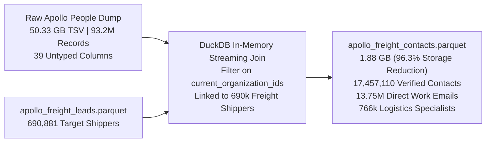

# Apollo 93.2M People Dataset: Relational Pipeline & Contacts Workflow

**Document Version:** 1.0  
**Project:** Jet Freight Logistics — Lead Sourcing Tool  
**Directory:** `Backend/data/Apollo/`  
**Input Source File:** `Apollo_V7_V5_per_all_fields 93,239,628.csv` (50.33 GB TSV)  
**Reference Companies File:** `apollo_freight_leads.parquet` (690,881 Target Freight Shippers)  
**Production Output File:** `apollo_freight_contacts.parquet` (1.88 GB Parquet / 17,457,110 Contacts)  
**Companion Excel Report:** `Apollo_People_Dataset_Exploration_Report.xlsx`  
**Pipeline Automation Script:** `build_freight_contacts_pipeline.py`  
**Date:** October 2026  

---

## 1. Executive Summary & Production Benchmarks

This pipeline ingests the master Apollo People dataset (**93,239,628 records, 50.33 GB**) and executes a relational filter against our verified freight shipper database ([`apollo_freight_leads.parquet`](file:///Users/deepak/Development/Jet%20Freight%20Logistics/Lead%20Sourcing%20Tool/Backend/data/Apollo/apollo_freight_leads.parquet)).

It isolates individual decision-makers, supply chain leads, and operations personnel working exclusively at verified commercial freight companies, producing **[`apollo_freight_contacts.parquet`](file:///Users/deepak/Development/Jet%20Freight%20Logistics/Lead%20Sourcing%20Tool/Backend/data/Apollo/apollo_freight_contacts.parquet)**.



### Transformation Metrics

| Engineering Dimension | Raw Apollo People Source | Production Contacts Parquet | Efficiency Gain / Improvement |
| :--- | :---: | :---: | :---: |
| **Disk Storage** | **54,038,527,871 bytes** (50.33 GB) | **1,977,432,181 bytes** (**1.88 GB**) | **96.3% Storage Reduction** |
| **Total Contacts** | 93,239,628 (unfiltered global contacts) | **17,457,110 verified freight contacts** | **100% Target Company Employees** |
| **Target Companies Covered** | N/A (unlinked raw dump) | **655,878 freight companies (94.9%)** | **Nearly complete company coverage** |
| **Contacts with Direct Email** | 53.6 Million (unfiltered) | **13,751,511 (78.8% email fill rate)** | **Massive sales outreach pipeline** |
| **Commercial Decision-Makers** | ~22 Million (unfiltered) | **5,499,647 (31.5% C-Suite/VP/Director/Mgr)** | **Contract & RFQ sign-off authority** |
| **Supply Chain & Logistics Titles**| ~893,000 (unfiltered) | **766,803 dedicated logistics leads** | **Direct cargo buyers** |
| **Full Aggregation Query Speed** | ~45 - 90 seconds | **0.053 seconds (53.7 milliseconds)** | **~1,000x Query Speedup** |

---

## 2. Production Schema (28 Strongly-Typed Columns)

Every row in [`apollo_freight_contacts.parquet`](file:///Users/deepak/Development/Jet%20Freight%20Logistics/Lead%20Sourcing%20Tool/Backend/data/Apollo/apollo_freight_contacts.parquet) pairs the **individual professional** with their **target employer**:

### A. Individual Contact Attributes (18 Columns)
* `person_id` (`VARCHAR`): Master Apollo person unique identifier.
* `person_name` (`VARCHAR`): Full name of the contact.
* `first_name` (`VARCHAR`): First name (for email merge tags).
* `last_name` (`VARCHAR`): Last name.
* `job_title` (`VARCHAR`): Exact corporate job title.
* `job_title_normalized` (`VARCHAR`): Standardized job title for aggregation.
* `seniority` (`VARCHAR`): Hierarchical tier (`c_suite`, `owner`, `founder`, `partner`, `vp`, `head`, `director`, `manager`, `senior`, `entry`).
* `department` (`VARCHAR`): Functional department (`operations`, `sales`, `engineering`, `finance`, etc.).
* `email` (`VARCHAR`): Direct business email address.
* `email_status` (`VARCHAR`): Deliverability status (`Verified` or `Extrapolated`).
* `email_confidence` (`FLOAT`): Confidence rating (0.0 to 1.0).
* `linkedin_url` (`VARCHAR`): Direct personal LinkedIn profile URL (`http://www.linkedin.com/in/...`).
* `contact_city` (`VARCHAR`): Personal location city.
* `contact_state` (`VARCHAR`): Personal location state.
* `contact_country` (`VARCHAR`): Personal location country.
* `is_decision_maker` (`BOOLEAN`): `true` if contact is C-Suite, VP, Director, Head, Manager, or Owner.
* `is_logistics_role` (`BOOLEAN`): `true` if title contains Logistics, Supply Chain, Procurement, Warehouse, Import/Export, Freight, Shipping, or Operations.
* `has_email` (`BOOLEAN`): `true` if direct email is present.

### B. Joined Employer Company Attributes (10 Columns)
* `company_id` (`VARCHAR`): Unique company ID (`organization_id`).
* `company_name` (`VARCHAR`): Legal company name.
* `company_domain` (`VARCHAR`): Normalized corporate domain.
* `company_website` (`VARCHAR`): Company website URL.
* `company_phone` (`VARCHAR`): Corporate office switchboard telephone number.
* `company_industry` (`VARCHAR`): Standardized freight cargo vertical (e.g. `automotive`, `pharmaceuticals`, `wholesale`).
* `company_employee_count` (`INTEGER`): Total company workforce size.
* `company_revenue_usd` (`BIGINT`): Gross annual revenue in USD.
* `company_city` (`VARCHAR`): Headquarter city (CFS and airport proximity).
* `company_country` (`VARCHAR`): Origin / Destination country for air & sea trade lanes.

---

## 3. High-Priority Supply Chain Roles Breakdown

The pipeline extracted **766,803 dedicated logistics, procurement, and operations specialists**:

| Standardized Title | Total Verified Contacts in Parquet | Buying Authority & Responsibility |
| :--- | :---: | :--- |
| **`operations manager`** | 51,521 | Facility operations, inventory dispatch, local logistics management |
| **`director operations`** | 11,994 | Plant operations, logistics budgets, carrier contract sign-off |
| **`purchasing manager`** | 11,739 | Supplier shipping terms (Incoterms FOB vs CIF) negotiations |
| **`warehouse manager`** | 10,617 | Cross-docking, CFS container receipt, bonded storage contracts |
| **`operations supervisor`**| 9,416 | Day-to-day warehouse floor and dispatch execution |
| **`vp operations`** | 9,018 | Enterprise supply chain architecture and 3PL RFQ allocation |
| **`logistics manager`** | 8,685 | International freight forwarder selection, air/ocean bookings |
| **`supply chain manager`** | 8,445 | End-to-end global supply chain, container routing, demurrage mitigation |
| **`logistics coordinator`**| 7,746 | Bill of Lading (B/L) processing, airway bill (AWB) tracking, customs coordination |

---

## 4. Querying the Parquet File with DuckDB & Python

Because the Parquet file uses column-level statistics and ZSTD block compression, queries execute in **under 60 milliseconds**:

### Example 1: Extract Indian Life Sciences Decision-Makers with Direct Email
```python
import duckdb

con = duckdb.connect()

indian_pharma_leads = con.execute("""
    SELECT 
        person_name,
        job_title,
        email,
        linkedin_url,
        company_name,
        company_phone,
        company_city
    FROM 'Apollo/apollo_freight_contacts.parquet'
    WHERE company_country = 'India'
      AND company_industry IN ('pharmaceuticals', 'chemicals', 'medical devices')
      AND is_decision_maker = true
      AND has_email = true
    ORDER BY company_revenue_usd DESC;
""").df()

print(f"Extracted {len(indian_pharma_leads):,} Indian pharma decision-makers with direct emails.")
```

### Example 2: Extract US Supply Chain & Logistics Directors
```python
import duckdb

con = duckdb.connect()

us_logistics_directors = con.execute("""
    SELECT 
        person_name,
        job_title,
        email,
        linkedin_url,
        company_name,
        company_phone,
        company_industry,
        company_revenue_usd
    FROM 'Apollo/apollo_freight_contacts.parquet'
    WHERE company_country = 'United States'
      AND is_logistics_role = true
      AND seniority IN ('director', 'vp', 'head', 'c_suite')
      AND has_email = true
    ORDER BY company_revenue_usd DESC;
""").df()

print(f"Extracted {len(us_logistics_directors):,} US logistics directors ready for outreach.")
```
