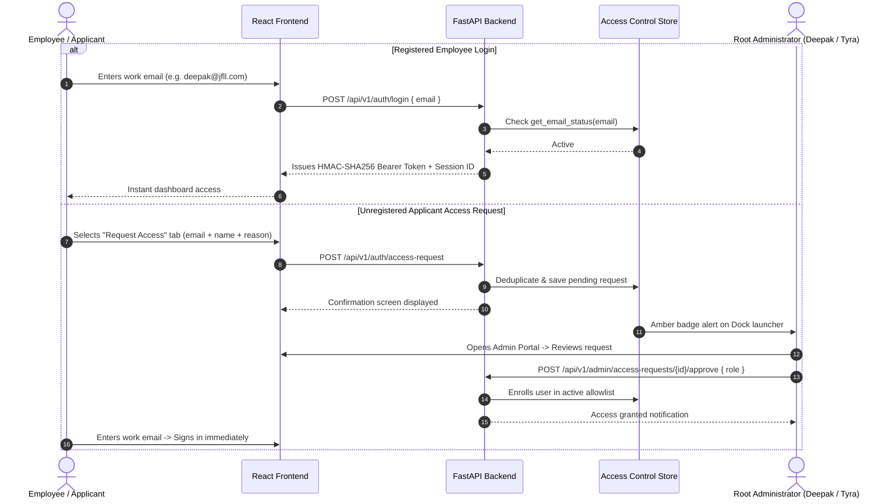

<div align="center">

# ⚡ JFLL LeadForge

### Enterprise Lead Sourcing, Trade Intelligence & Access Management Platform

[]()
[]()
[]()
[]()
[]()
[]()
[]()
[](https://d3c4bsffw7tf7s.cloudfront.net)

<p align="center">
  <b>Production CloudFront:</b> <a href="https://d3c4bsffw7tf7s.cloudfront.net">https://d3c4bsffw7tf7s.cloudfront.net</a> &nbsp;|&nbsp;
  <b>Backend Serverless API:</b> <code>https://uxfmnbd6owxk3wxemhizp4gqsa0exlge.lambda-url.ap-southeast-2.on.aws</code>
</p>

</div>

---

## 🧭 Executive Overview

**JFLL LeadForge** is an enterprise-grade commercial prospecting and customer intelligence suite engineered specifically for **Jet Freight Logistics Limited (JFLL)**.

By pairing a **vectorized columnar analytical engine** (DuckDB querying Zstandard-compressed Parquet directly over AWS S3) with a **React 18 single-page application**, LeadForge delivers sub-10ms analytical queries across millions of verified supply chain decision makers, commercial cargo shippers, customs shipments, and internal account relationships.

---

## 🏛️ System Architecture

```mermaid
flowchart TD
    subgraph Client["Browser Client (React 18 SPA)"]
        UI["JFLL Dashboard UI\n(Tailwind CSS + Lucide Icons)"]
        Views["Core Views\n(Apollo People | Apollo Companies | DataMyne | JFLL Master)"]
        AdminUI["Root Admin Portal Modal\n(Allowlist | Access Requests | Audit Log)"]
        State["State & Cache Layer\n(TanStack Query + Table + sessionStorage)"]
        Logger["Client Logger\n(__APP_LOGS__ Ring-Buffer)"]
        UI --> Views
        UI --> AdminUI
        Views --> State
        AdminUI --> State
        Views --> Logger
    end

    subgraph Edge["Global Edge Distribution"]
        CF["AWS CloudFront Global CDN\n(https://d3c4bsffw7tf7s.cloudfront.net)"]
    end

    subgraph Compute["Serverless Backend Services"]
        APIGW["Lambda Function URL\n(HTTPS Preflight & CORS Handlers)"]
        Lambda["AWS Lambda (Python 3.12 / x86_64)\n(FastAPI + Mangum Adapter)"]
        SecurityMW["Defense Perimeter\n(AntiBotMiddleware + SecurityHeaders)"]
        AuthModule["HMAC-SHA256 Auth\n(Single-Device Session Displacement)"]
        AccessCtrl["Access Control Engine\n(Atomic Writes + In-Memory O(1) Cache)"]
        DuckDB["DuckDB Analytical Engine\n(Columnar Execution + In-Memory HTTPFS)"]
        TmpCache["Ephemeral /tmp NVMe Cache\n(Warm Latency: 2–5ms | 0 S3 GETs)"]
        
        APIGW --> SecurityMW --> Lambda
        Lambda --> AuthModule
        Lambda --> AccessCtrl
        Lambda --> DuckDB
        DuckDB <--> TmpCache
    end

    subgraph Storage["Cloud Storage & Observability"]
        S3Web["AWS S3: Static Web Bundle\n(jfll-leadforge-frontend)"]
        S3Data["AWS S3: ZSTD Parquet Datasets\n(jfll-leadforge-data)"]
        CW["AWS CloudWatch\n(Structured JSON Telemetry)"]
    end

    Client -->|Static Assets (HTML/JS/CSS)| CF
    CF -->|Origin: Private OAC| S3Web
    Client -->|REST API Requests (Bearer Token)| CF
    CF -->|Path: /api/v1/*| APIGW
    DuckDB -->|HTTPFS Parquet Stream (Cold Start)| S3Data
    Lambda -->|CloudWatchJSONFormatter| CW
```

---

## 💎 Core Prospecting Engines & Modules

### 1. 🛡️ Root Administration Portal & Access Pipeline
- **Public Self-Service Access Request:** Prospective users submit their work email, full name, and business reason directly from the login screen. Deduplication and authorized-user detection provide instant feedback.
- **Dock Notification Badge:** Administrators see an active amber counter on the bottom dock whenever pending requests arrive.
- **Three-Tier Administrative Modal:**
  - **Pending Requests:** Review applicant credentials with full context and assign functional roles (*Commercial*, *Operations*, *Sales*, *Tech Lead*, *Leadership*, *Admin*) upon approval.
  - **Active Allowlist:** Live directory of all authorized personnel with search, direct addition (`+ Add Personnel`), and access revocation.
  - **Audit History:** Full immutable record of all historical approvals, rejections, reviewer notes, and timestamps.
- **Root Admin Immunity & Self-Lockout Prevention:** Core administrators (`deepak@jfll.com`, `tyra.theknath@jfll.com`) are protected from accidental revocation, and admins cannot revoke their own active accounts.

### 2. 🎯 SOP Tier A / Tier B Lead Segmentation Engine
- **37,273 Scored Trade Records:** Automated scoring based on the JFLL Lead Generation SOP (Shipment frequency, freight control Incoterms, trade lane fit, commodity classification, mode suitability, volume trends, and recency).
- **Capacity Monitoring:** Real-time capacity tracker auditing Tier A lead quotas against the 150 leads/month commercial sales guideline.
- **Multi-Faceted Combinatorial Filtering:** Seamlessly combines status (`Tier A`, `Tier B`, `Parked`), score ranges, categories (e.g. *Perishables*), hub cities (e.g. *Mumbai*), and transport modes (*Air* / *Ocean*).
- **DSA Single-Pass Optimization:** Evaluates 14 filter criteria in a single $O(N)$ pass with $O(1)$ `Set` lookups, replacing 500,000+ intermediate array allocations.

### 3. 🏢 Apollo Commercial Freight Shippers (Accounts Directory)
- **690,881 Commercial Accounts:** Verified commercial cargo shippers requiring international Air, Ocean, Reefer, and Customs Clearance services.
- **50 Logistics Cargo Verticals:** Filter by Automotive, Chemicals, Pharmaceuticals, Fresh Produce, Electronics, Machinery, and Textiles.
- **Cross-Directory Pivot:** One-click **"Find Decision Makers"** button queries the People directory scoped to cargo buyers at that specific company.
- **Comprehensive Dossier Slide-Over:** Detailed firmographics, website and LinkedIn shortcuts, employee headcount tiers, annual revenue estimates, and technology stack tags.

### 4. 👥 Apollo Decision Makers (People Directory)
- **15.5M Contacts with 766k+ Dedicated Freight Specialists:** High-intent supply chain leads, import/export managers, logistics directors, VP of operations, and procurement heads across 686k companies.
- **Streamlined Role Filters:** Instant toggles for **Logistics Roles Only** (`is_logistics_role = true`) and **Decision Makers Only** (`is_decision_maker = true`).
- **Standardized Job Title Targeting:** Autocomplete multi-select across standard freight titles (*"Logistics Director"*, *"Supply Chain Manager"*, *"Head of Import & Export"*, *"Procurement Lead"*, etc.).
- **Deliverability & Outreach Readiness:** Confidence ratings with direct phone numbers and verified LinkedIn profiles.

### 5. 🌐 DataMyne International Trade Intelligence
- **40,081 Import/Export Accounts:** Cleaned and deduplicated trade records spanning **India** (34,690 accounts) and **Brazil** (5,391 accounts).
- **Air & Ocean Segmentation:** Dedicated filters for transport mode (`Air`, `Ocean`, `Air & Ocean`).
- **Context-Aware Geographic Filtering:** Dynamic UI switches between India-specific and Brazil-specific trade corridors (`PER/AIR`, `GCR/Air`, `India-Brazil/Air`, `Brazil-India/Air`, `Brazil-India/Ocean`) and regional hubs.
- **Customs Shipment Metrics:** Track shipment frequencies, estimated cargo traded value (USD), and HS code categories.

### 6. 📊 JFLL Internal Customer Intelligence
- **728 Active Enterprise Accounts & 2,010 Inactive Accounts:** Internal master customer directory with contact readiness scoring and relationship tracking.
- **Revenue-Based Filter Tiers:** Instant segmentation by historical 3-month business (₹1Cr+, ₹25L–₹1Cr, ₹5L–₹25L, ₹1L–₹5L, <₹1L).
- **Interactive Sorting:** Multi-column sorting across Company Name, 3-Month Revenue, Customer Group, Credit Status, Contact Person, and Sales Representative.
- **CWE-1236 Formula Injection Shielding:** Clean streaming RFC-4180 CSV export with formula injection sanitization.

---

## ⚡ Technical Stack & Specifications

| Layer | Component | Description |
| :--- | :--- | :--- |
| **Frontend Framework** | React 18.3 + Vite 6.4 | Modern single-page application with lightning-fast HMR and modular views |
| **Language & Typings** | TypeScript 5.6 | Strict type-safety, zero `any` slips, comprehensive interfaces |
| **UI & Styling** | Tailwind CSS 3.4 + Lucide React | Clean enterprise design tokens with dark-mode accents and responsive layout |
| **State & Virtualization** | TanStack Query 5 + Table 8 | Intelligent cache invalidation, background revalidation, and table virtualization |
| **Backend Framework** | Python 3.11+ / FastAPI 0.115 | High-throughput asynchronous ASGI framework with automated OpenAPI docs |
| **Analytical Query Engine** | DuckDB 1.1 + HTTPFS | Vectorized analytical queries reading S3 Parquet partitions in single passes |
| **Data Format** | Apache Parquet (Zstandard) | Columnar storage with snappy compression, dictionary encoding, and statistics |
| **Security & Cryptography** | RFC 7519 HMAC-SHA256 | Constant-time `secrets.compare_digest` validation and single-device displacement |
| **Persistence** | Atomic JSON Engine | Mutex synchronization (`_ACCESS_LOCK`) + crash-resilient `os.replace` writes |
| **Cloud Hosting** | AWS S3 + CloudFront + Lambda | Serverless perpetual free tier deployment with global edge CDN distribution |

---

## 📁 Repository Structure

```
Lead Sourcing Tool/
├── README.md                            # Complete system documentation (this file)
├── .gitignore                           # Git ignore specification
│
├── Frontend/                            # React 18 SPA application
│   ├── src/
│   │   ├── main.tsx                     # Application bootstrap & TanStack Query setup
│   │   ├── App.tsx                      # Root orchestrator & tab controller
│   │   ├── components/
│   │   │   ├── admin/                   # Root Administration Portal & Access Modals
│   │   │   │   ├── AdminPortalModal.tsx # 3-tab access control modal (Pending, Allowlist, History)
│   │   │   │   └── index.ts             # Barrel export
│   │   │   ├── auth/                    # LoginPage component & Access Request self-service form
│   │   │   ├── layout/                  # AppDock, TopHeader, AppLayout shells
│   │   │   ├── views/                   # Modularized View Architecture (People, Companies, DataMyne, JFLL)
│   │   │   ├── tiers/                   # SOP Tier A/B breakdown cards, badges, and capacity widgets
│   │   │   ├── apollo/                  # Apollo tables, slide-over drawer, context banners
│   │   │   ├── datamyne/                # DataMyne tables, corridor filters, action bars
│   │   │   ├── jfll/                    # Customer master table, revenue filters, skeletons
│   │   │   └── ui/                      # Reusable badges, dialogs, toasts
│   │   ├── services/                    # Typed API services (adminService, authService, tierService, etc.)
│   │   ├── types/                       # TypeScript interfaces (admin.ts, tierSegmentation.ts, etc.)
│   │   ├── test/                        # Vitest suite (240 tests across 22 test files)
│   │   └── utils/                       # Shared formatters, parsers, and telemetry
│   └── package.json                     # Frontend dependencies and scripts
│
├── Backend/                             # FastAPI microservice & DuckDB engine
│   ├── src/
│   │   ├── api/
│   │   │   ├── main.py                  # FastAPI bootstrap, CORS configuration, security middleware
│   │   │   ├── access_control.py        # Thread-safe atomic access control engine with O(1) cache
│   │   │   ├── admin_routes.py          # Administrative endpoints (allowlist, access requests, stats)
│   │   │   ├── auth.py                  # HMAC-SHA256 session token management & bot blocker
│   │   │   ├── tier_routes.py           # SOP Tier A/B lead query and distribution endpoints
│   │   │   ├── routes.py                # Paginated lead query endpoints & DuckDB execution
│   │   │   ├── config.py                # Typed settings (Pydantic)
│   │   │   ├── database.py              # DuckDB + S3 HTTPFS connection factory
│   │   │   ├── models.py                # Pydantic request and response schemas
│   │   │   └── logger.py                # Structured CloudWatch JSON logging middleware
│   │   ├── core/                        # Tier scoring business rules & SOP criteria
│   │   ├── etl/                         # Data ingestion pipelines (India, Brazil, Apollo)
│   │   └── services/                    # Pure Python scoring engine
│   ├── tests/                           # Pytest suite (94 tests across 12 test modules)
│   └── requirements.txt                 # Backend Python dependencies
│
└── docs/                                # Technical governance & specifications
    ├── architecture/
    │   ├── TECH_STACK.md                # Architectural decisions & library criteria
    │   └── parquet-duckdb-optimization-guide.md # Analytical Parquet tuning guide
    └── reference/
        └── tier_segmentation_spec.md    # Official JFLL Lead Generation SOP Specification
```

---

## 🚀 Quickstart & Local Setup

### Prerequisites
- **Node.js**: `v18.0.0+` (Node 20 LTS recommended)
- **Python**: `v3.11+`
- **Package Managers**: `npm` and `pip` (or `uv`)

---

### 1. Backend Setup

```bash
# Navigate to the backend directory
cd Backend

# Create and activate Python virtual environment
python3 -m venv .venv
source .venv/bin/activate

# Install dependencies
pip install -r requirements.txt

# Start the FastAPI server (Hot reload enabled)
PYTHONPATH=. uvicorn src.api.main:app --host 0.0.0.0 --port 8000 --reload
```

- **Healthcheck:** `http://localhost:8000/health`
- **Interactive OpenAPI Documentation:** `http://localhost:8000/docs`

---

### 2. Frontend Setup

```bash
# Navigate to the frontend directory
cd Frontend

# Install dependencies
npm install

# Start the Vite development server
npm run dev
```

The application will launch at **`http://localhost:5173`**.

---

## 🔐 Authentication & Access Model

LeadForge enforces **passwordless work-email allowlist authentication**:



---

## 🧪 Testing & Verification

Both test suites provide 100% regression and quality proof:

```bash
# Run Full Backend Pytest Suite (94 Tests)
cd Backend
.venv/bin/pytest -v

# Run Full Frontend Vitest Suite (240 Tests across 22 Files)
cd Frontend
npm test -- --run

# Run TypeScript Production Build
cd Frontend
npm run build
```

---

## 📜 License & Governance

**Proprietary and Confidential.**  
Copyright © 2026 **Jet Freight Logistics Limited (JFLL)**. All rights reserved.  
Unauthorized copying, reverse-engineering, or redistribution is strictly prohibited.
