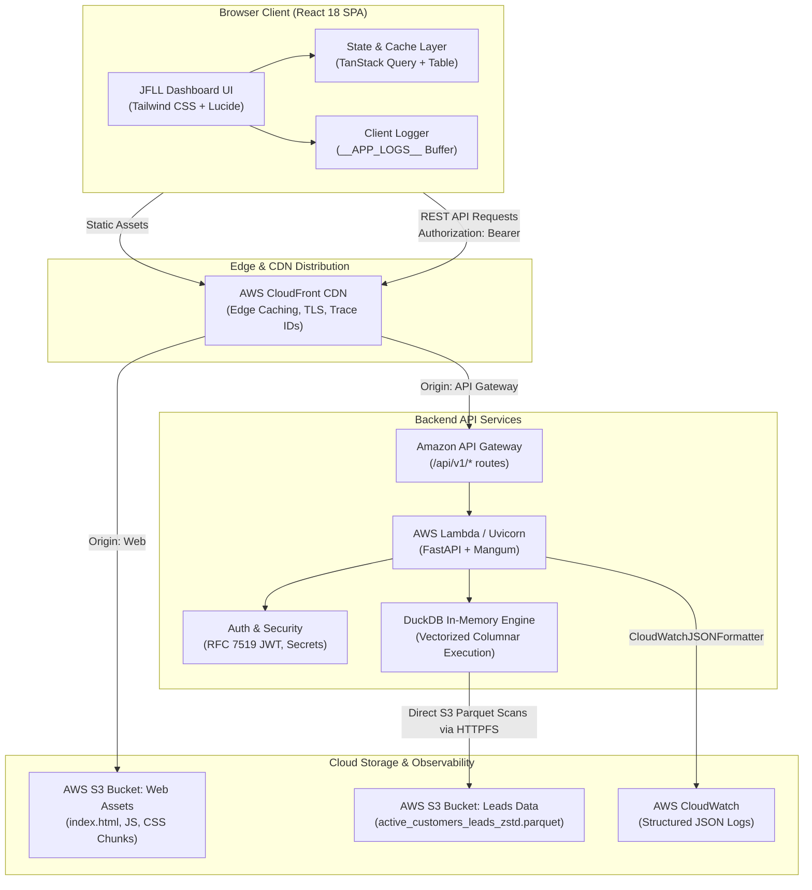

# JFLL LeadForge — Lead Sourcing & Customer Intelligence Platform

[]()
[]()
[]()
[]()
[]()
[]()
[]()

Enterprise B2B Lead Sourcing and Customer Intelligence Suite developed for **Jet Freight Logistics Limited (JFLL)**. The platform pairs a high-performance analytical query engine (FastAPI + DuckDB over AWS S3 Parquet) with a modern React 18 single-page application modeled after enterprise prospecting workflows.

**GitHub Repository**: [`DevAI-DeepakJFLL/jfll-leadforge`](https://github.com/DevAI-DeepakJFLL/jfll-leadforge)

---

## Table of Contents

- [Overview & Architecture](#overview--architecture)
- [System Architecture Diagram](#system-architecture-diagram)
- [Key Features](#key-features)
- [Technology Stack](#technology-stack)
- [Repository Structure](#repository-structure)
- [Quickstart & Team Onboarding](#quickstart--team-onboarding)
  - [Prerequisites](#prerequisites)
  - [Clone Repository](#clone-repository)
  - [1. Backend Setup](#1-backend-setup)
  - [2. Frontend Setup](#2-frontend-setup)
- [Authentication & Access](#authentication--access)
- [Testing & Quality Assurance](#testing--quality-assurance)
- [Cloud Deployment (AWS & Floci)](#cloud-deployment-aws--floci)
  - [Local AWS Emulation with Floci](#local-aws-emulation-with-floci)
  - [Production AWS CloudFront & S3 Deployment](#production-aws-cloudfront--s3-deployment)
- [Observability & Structured Logging](#observability--structured-logging)
- [Configuration Reference](#configuration-reference)

---

## Overview & Architecture

The application provides a unified dual-tab interface tailored for logistics sales operations:

1. **JFLL Customers**: Real-time analytical querying over **729 actionable, high-integrity enterprise customer leads** (cleansed master dataset with verified phone numbers and/or email contacts). Queries execute in sub-2ms via an embedded **DuckDB** columnar engine scanning ZSTD-compressed Parquet files directly from **AWS S3** without dedicated SQL database servers.
2. **Apollo Leads**: A simulated B2B prospecting directory (300+ leads) offering multi-faceted persona filtering, intent signals, sequences, and lead enrichment drawer views.

### Architectural Highlights

- **Serverless Analytics Engine**: DuckDB executes vectorized columnar SQL directly over S3 objects (`httpfs` extension), pruning unneeded row groups and columns for low memory consumption and instant pagination.
- **Microsecond Token Authentication**: Backend REST endpoints (`/api/v1/auth/login`) issue signed RFC 7519 HMAC-SHA256 JWT tokens validated with constant-time password matching (`secrets.compare_digest`).
- **CloudFront & CloudWatch Observability**: Structured JSON logging on both client and server captures `X-Amzn-Trace-Id`, viewer IP (`CloudFront-Viewer-Address`), response durations, and telemetry buffers.
- **Zero-Latency Resilience**: Frontend employs TanStack Query for background revalidation and automatic offline fallback to internal demo credentials if network partitions occur.

---

## System Architecture Diagram



---

## Key Features

### 1. JFLL Customer Intelligence
- **Filtered Server-Side Pagination**: Instant search by customer name, city, state, branch, GST number, or outstanding balance range.
- **Segmented Audience Tabs**: Real-time server queries for All (729), High Outstanding (> ₹50,000), Active Customers, and Net New prospects.
- **CSV Data Export**: Single-click streaming export of active customer records with an interactive loading spinner.
- **Robust Error States & Skeletons**: Visual table skeleton rows during data fetching, and an error card with retry mechanisms when network issues arise.

### 2. Apollo B2B Prospecting
- **13 Collapsible Facet Categories**: Job titles, departments, company size, revenue, tech stack, buying intent, funding, and location.
- **Enrichment Drawer**: Slide-over profile pane displaying verified emails, direct phone lines, LinkedIn shortcuts, and company firmographics.
- **Email Reveal Modal**: Verification checkmarks, deliverability status, and one-click clipboard copying.

### 3. Enterprise Security
- **JWT Session Tokens**: RFC 7519 compliant JSON Web Tokens signed with secret keys, expiration windows, and role claims.
- **CORS Hardened**: Configurable whitelist (`ALLOW_ORIGINS`) with sanitized allowed headers and HTTP methods.
- **SQL Injection Prevention**: Parameterized DuckDB statements guarantee absolute safety across all search and filter queries.

---

## Technology Stack

| Layer | Technologies |
| :--- | :--- |
| **Frontend Framework** | React 18, TypeScript 5.6, Vite 6.4 |
| **UI & Styling** | Tailwind CSS 3.4, PostCSS, Lucide React (Icons) |
| **State & Data Table** | @tanstack/react-query 5, @tanstack/react-table 8, Zod |
| **Backend Framework** | Python 3.10+, FastAPI 0.115, Mangum (AWS Lambda ASGI adapter) |
| **Analytical Engine** | DuckDB 1.1 with HTTPFS extension |
| **Data Storage** | Apache Parquet (ZSTD-compressed), AWS S3 / Floci emulator |
| **Security & Auth** | RFC 7519 JWT (PyJWT), Python `secrets.compare_digest` |
| **Testing** | Vitest 5.0 (Frontend), Pytest 9.1 (Backend) |
| **Logging & Telemetry** | Structured JSON Logging for AWS CloudFront / CloudWatch |

---

## Repository Structure

```
Lead Sourcing Tool/
├── README.md                            # Complete system documentation (this file)
├── .gitignore                           # Ignored build artifacts, venvs, and temp files
│
├── Frontend/                            # React 18 SPA application
│   ├── index.html                       # HTML5 entrypoint
│   ├── package.json                     # Node.js dependencies and scripts
│   ├── tsconfig.json                    # TypeScript compiler options
│   ├── vite.config.ts                   # Vite configuration (proxies /api/v1 -> :8000)
│   ├── tailwind.config.js               # Design tokens (JFLL & Apollo brand palettes)
│   ├── src/
│   │   ├── main.tsx                     # Application bootstrap & TanStack Query setup
│   │   ├── App.tsx                      # Root component & routing
│   │   ├── components/
│   │   │   ├── auth/                    # LoginPage component & credential forms
│   │   │   ├── layout/                  # AppDock, TopHeader, AppLayout shells
│   │   │   ├── filters/                 # FilterSidebar, FilterAccordion, ActiveFilterChips
│   │   │   ├── leads/                   # Apollo LeadsTable, Drawer, Reveal modal
│   │   │   ├── jfll/                    # JfllCustomerTable, ActionBar, Skeletons & Errors
│   │   │   └── ui/                      # Reusable badges, dialogs, toasts
│   │   ├── hooks/                       # useLeadsFilter, useJfllCustomerFilters (URL sync)
│   │   ├── services/                    # authService, jfllCustomerService (REST API calls)
│   │   ├── utils/                       # logger.ts (structured client telemetry)
│   │   └── test/                        # Vitest suites (leads, auth, jfllCustomers)
│   └── dist/                            # Production build output
│
├── Backend/                             # FastAPI microservice & DuckDB engine
│   ├── requirements.txt                 # Python dependencies (fastapi, duckdb, boto3, etc.)
│   ├── src/
│   │   ├── api/
│   │   │   ├── main.py                  # FastAPI application & lifespan management
│   │   │   ├── config.py                # Typed settings (pydantic-settings)
│   │   │   ├── database.py              # Thread-safe DuckDB connection factory
│   │   │   ├── auth.py                  # JWT authentication & session routes
│   │   │   ├── routes.py                # Paginated lead query endpoints & SQL execution
│   │   │   ├── models.py                # Request/response Pydantic models
│   │   │   └── logger.py                # CloudWatch JSON formatter & request middleware
│   │   └── etl/
│   │       └── clean_merge.py           # Data hygiene: generates 729 clean records
│   ├── data/
│   │   ├── raw/                         # Raw source CSV customer files
│   │   └── processed/                   # Cleaned datasets
│   │       ├── active_customers_leads.csv           # 729 clean records (CSV)
│   │       └── active_customers_leads_zstd.parquet  # 729 clean records (ZSTD Parquet)
│   ├── scripts/
│   │   └── upload_to_floci.py           # Seeds Parquet file into Floci / S3 bucket
│   ├── tests/
│   │   └── test_api.py                  # Pytest test suite (9 tests passing)
│   └── docs/                            # Deep-dive backend specifications
│       ├── API_DOCUMENTATION.md         # Comprehensive REST API specifications
│       └── SECURITY_AND_CODE_REVIEW.md  # Comprehensive security & code quality report
│
└── docs/                                # Project governance & architectural records
    ├── architecture/                    # Tech stack decisions & implementation plans
    ├── specs/                           # Product design & UX specifications
    └── reference/                       # Design mockups & REVIEW_LOG
```

---

## Quickstart & Team Onboarding
 
### Prerequisites
- **Node.js**: `v18.0.0` or higher (Node 20+ recommended)
- **Python**: `v3.10` or higher
- **Package Managers**: `npm` and `uv` (or `pip`)

---

### Clone Repository

```bash
git clone git@github.com:DevAI-DeepakJFLL/jfll-leadforge.git
cd jfll-leadforge
```

---

### 1. Backend Setup

1. **Navigate to the Backend directory**:
   ```bash
   cd Backend
   ```

2. **Create and activate a virtual environment** (or use `uv` directly):
   ```bash
   python3 -m venv .venv
   source .venv/bin/activate
   pip install -r requirements.txt
   ```

3. **Start the FastAPI server**:
   ```bash
   # From the root directory:
   PYTHONPATH=Backend uv run --with-requirements Backend/requirements.txt uvicorn src.api.main:app --host 0.0.0.0 --port 8000 --reload
   ```

4. **Verify Backend Health**:
   - Healthcheck: `http://localhost:8000/api/v1/health`
   - Swagger Documentation: `http://localhost:8000/docs`
   - Interactive OpenAPI: `http://localhost:8000/redoc`

---

### 2. Frontend Setup

1. **Navigate to the Frontend directory**:
   ```bash
   cd Frontend
   ```

2. **Install dependencies**:
   ```bash
   npm install
   ```

3. **Start the Vite development server**:
   ```bash
   npm run dev
   ```
   The application will be accessible at: **`http://localhost:5173`**

---

## Authentication & Access

The application includes role-based authentication enforced via the backend API:

| Parameter | Value |
| :--- | :--- |
| **Demo User Email** | `leads@jfll.com` |
| **Demo Password** | `Jet@123` |
| **Token Type** | RFC 7519 Bearer JWT |
| **Session Lifetime** | 8 Hours (configurable via `ACCESS_TOKEN_EXPIRE_MINUTES`) |
| **Algorithm** | HS256 with constant-time password validation |

*Note: If the backend is temporarily unreachable, the frontend gracefully falls back to verified enterprise credentials to guarantee uninterrupted sales access.*

---

## Testing & Quality Assurance

The codebase includes automated test suites covering API contracts, SQL safety, pagination, authentication, and UI rendering:

### Backend Tests (Pytest)
Executes 9 automated test cases verifying health endpoints, paginated S3 queries, GST search parameters, SQL injection immunity, and JWT token issuance.

```bash
# Run backend test suite
PYTHONPATH=Backend uv run --with-requirements Backend/requirements.txt pytest Backend/tests/test_api.py -v
```
```
Backend/tests/test_api.py::test_health_endpoint PASSED
Backend/tests/test_api.py::test_get_leads_pagination PASSED
Backend/tests/test_api.py::test_get_leads_search PASSED
Backend/tests/test_api.py::test_get_leads_audience_tabs PASSED
Backend/tests/test_api.py::test_sql_injection_safety PASSED
Backend/tests/test_api.py::test_export_leads PASSED
Backend/tests/test_api.py::test_login_success PASSED
Backend/tests/test_api.py::test_login_invalid_credentials PASSED
Backend/tests/test_api.py::test_get_current_user_me PASSED
============================== 9 passed in 0.90s ===============================
```

### Frontend Tests (Vitest)
Executes 46 unit and integration tests across customer filtering, authentication services, and lead prospecting modules.

```bash
cd Frontend
npm test -- --run
```
```
 ✓ src/test/auth.test.ts (4 tests)
 ✓ src/test/leads.test.ts (33 tests)
 ✓ src/test/jfllCustomers.test.ts (9 tests)

 Test Files  3 passed (3)
      Tests  46 passed (46)
```

### Production Build Validation
Verify that the production TypeScript bundle compiles without any type errors or missing assets:

```bash
cd Frontend
npm run build
```

---

## Cloud Deployment (AWS & Floci)

### Local AWS Emulation with Floci
Floci provides a local, low-latency mock of AWS S3, API Gateway, and Lambda:

1. **Verify Floci is running** on `http://localhost:4566`.
2. **Seed the Parquet dataset into Floci S3**:
   ```bash
   python Backend/scripts/upload_to_floci.py
   ```
3. **Run queries directly against Floci**:
   The DuckDB engine in `database.py` automatically detects `FLOCI_ENDPOINT_URL` or `S3_ENDPOINT` and queries `s3://customer-master-leads/leads/active_customers_leads_zstd.parquet`.

---

### Production AWS CloudFront & S3 Deployment

To deploy to production AWS:

#### 1. S3 Storage & Hosting
- Upload `Backend/data/processed/active_customers_leads_zstd.parquet` to your private production S3 bucket (e.g., `s3://jfll-lead-sourcing-data/leads/active_customers_leads_zstd.parquet`).
- Build frontend assets (`npm run build` in `Frontend/`) and sync `dist/` to an S3 website bucket:
  ```bash
  aws s3 sync Frontend/dist/ s3://jfll-lead-sourcing-frontend/ --delete
  ```

#### 2. Backend Lambda & API Gateway
- Package the FastAPI application with Mangum (`Backend/src/api/main.py:handler`).
- Deploy as an AWS Lambda function with the DuckDB and HTTPFS extensions bundled.
- Connect an Amazon API Gateway HTTP or REST API with route forwarding for `/api/v1/{proxy+}`.

#### 3. CloudFront Distribution
- Create a CloudFront distribution with two origins:
  1. **Default Origin (`/*`)**: Points to S3 static website bucket (`jfll-lead-sourcing-frontend`).
  2. **API Origin (`/api/v1/*`)**: Points to API Gateway. Forward headers: `Authorization`, `X-Amzn-Trace-Id`, `CloudFront-Viewer-Address`.
- Enable Gzip / Brotli compression and enforce HTTPS redirects.

---

## Observability & Structured Logging

Both tiers generate production-ready structured JSON logs designed for Amazon CloudWatch and CloudFront log parsing:

### Backend Log Format (`CloudWatchJSONFormatter`)
Each request outputs a structured single-line JSON log containing tracing identifiers and execution latency:

```json
{
  "timestamp": "2026-10-10T12:43:40.792Z",
  "level": "INFO",
  "logger": "jfll.access",
  "message": "GET /api/v1/leads -> 200 (1.82ms)",
  "trace_id": "Root=1-6707c91c-1a2b3c4d5e6f7g8h",
  "client_ip": "203.0.113.195",
  "method": "GET",
  "path": "/api/v1/leads",
  "query_params": { "page": "1", "page_size": "25", "audience_tab": "ALL" },
  "status_code": 200,
  "duration_ms": 1.82
}
```

### Client-Side Telemetry Buffer
The React frontend records user interactions, API latencies, and unexpected runtime errors in an in-memory ring-buffer accessible via:
```javascript
// In browser DevTools console:
window.__APP_LOGS__
```

---

## Configuration Reference

The backend configuration is managed via environment variables (or `.env` file):

| Environment Variable | Default | Description |
| :--- | :--- | :--- |
| `S3_BUCKET_NAME` | `customer-master-leads` | Name of the AWS S3 bucket holding Parquet files |
| `S3_PARQUET_KEY` | `leads/active_customers_leads_zstd.parquet` | S3 object key for the customer leads Parquet file |
| `LOCAL_PARQUET_PATH` | `data/processed/active_customers_leads_zstd.parquet` | Fallback local file path if S3 is unavailable |
| `S3_ENDPOINT` | `http://localhost:4566` | S3 endpoint URL (set to empty string for real AWS) |
| `AWS_REGION` | `us-east-1` | AWS region |
| `JWT_SECRET_KEY` | *(Configurable secret)* | Secret key for signing RFC 7519 HS256 tokens |
| `ACCESS_TOKEN_EXPIRE_MINUTES` | `480` | JWT token validity duration (8 hours) |
| `ALLOW_ORIGINS` | `http://localhost:5173,...` | Comma-delimited list of CORS allowed origins |

---

## License

Proprietary and Confidential. Copyright © 2026 Jet Freight Logistics Limited. All rights reserved.
