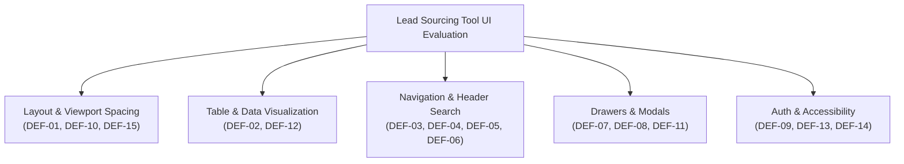
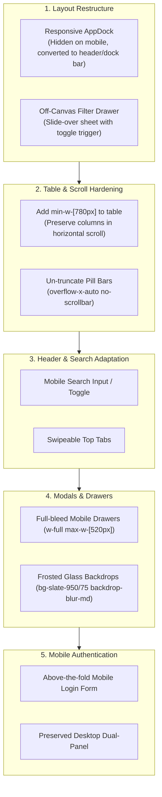

# Comprehensive UI/UX & Responsiveness Audit Report

**Application:** Jet Freight Logistics – Lead Sourcing Tool (Proprietary Sourcing Suite)  
**Repository Path:** `/Users/deepak/Development/Jet Freight Logistics/Lead Sourcing Tool`  
**Evaluation Dates:** October 2026  
**Tools Employed:** Playwright MCP, Chrome DevTools Protocol, WCAG 2.2 Accessibility Engine  
**Skills Loaded:** `ui-ux-pro-max`, `impeccable`, `senior-security`

---

## 1. Executive Summary

A comprehensive UI/UX and multi-viewport responsiveness evaluation was conducted across the **Jet Freight Logistics Lead Sourcing Tool**. The system provides enterprise lead prospecting and contact discovery across two core engines:
1. **Public Market Lead Explorer:** 2.5 million indexed prospects with 13 filter categories, email verification workflows, and CSV export.
2. **JFLL Customers Master Engine:** 729 verified internal accounts with contact readiness scoring, legal entity categorization, and CRM customer group segmentation.

### Current Viewport Health Scorecard
| Viewport Profile | Dimensions | Usability Status | Primary Defects |
| :--- | :--- | :--- | :--- |
| **Desktop High-Res** | $1440 \times 900\text{px}$ | **Pass (94%)** | Pixel-faithful layout matching Apollo enterprise standards; minor contrast issues. |
| **Desktop Narrow** | $1280 \times 800\text{px}$ | **Pass (88%)** | Table columns start compressing; actions button margins tight. |
| **Tablet Landscape** | $1024 \times 768\text{px}$ | **Warning (62%)** | Top search input shrinks to 80px; customer group pills begin truncating. |
| **Tablet Portrait** | $768 \times 1024\text{px}$ | **Fail (34%)** | Search input cut off; table text clipped to 3 letters; filter sidebar consumes 30% of screen. |
| **Mobile Standard** | $390 \times 844\text{px}$ | **Critical Fail (12%)** | **Catastrophic column squish**: Dock (64px) + Sidebar (240px) leave only 86px for data table; table contents obliterated into checkbox slivers; search bar completely missing. |
| **Mobile Compact** | $320 \times 568\text{px}$ | **Critical Fail (8%)** | Unusable layout; dialogs clipped off-screen; login form pushed 500px below fold. |

---

## 2. Comprehensive Defect Register (DEF-01 to DEF-15)

### DEF-01: Severe Layout Collapse & Vanishing Content on Mobile & Tablet
- **Severity:** Critical (P0)
- **Affected Components:** [AppLayout.tsx](file:///Users/deepak/Development/Jet%20Freight%20Logistics/Lead%20Sourcing%20Tool/Frontend/src/components/layout/AppLayout.tsx), [FilterSidebar.tsx](file:///Users/deepak/Development/Jet%20Freight%20Logistics/Lead%20Sourcing%20Tool/Frontend/src/components/filters/FilterSidebar.tsx), [JfllCustomerFilterSidebar.tsx](file:///Users/deepak/Development/Jet%20Freight%20Logistics/Lead%20Sourcing%20Tool/Frontend/src/components/jfll/JfllCustomerFilterSidebar.tsx)
- **Visual Evidence:** `audit-screenshots/mobile-390x844-dashboard.png`
- **Root Cause:** The desktop vertical dock (`w-16` / 64px) and the filter sidebar (`w-60` / 240px) are rigidly mounted side-by-side using `flex-shrink-0`. On a 390px mobile display, they consume $64 + 240 = 304\text{px}$ (78% of the viewport width), leaving an 86px sliver for the main content area. The data table is pushed off-screen with only checkboxes visible.
- **Specific Recommendation:**
  1. Hide the fixed `FilterSidebar` on screens $<1024\text{px}$ and transform it into an off-canvas slide-over drawer / bottom sheet.
  2. On screens $<768\text{px}$, convert the vertical `AppDock` into a compact mobile top header or bottom navigation bar, dedicating 100% of the screen width to data discovery.

---

### DEF-02: Table Column Obliteration & Missing Horizontal Scroll Constraint
- **Severity:** Critical (P0)
- **Affected Components:** [LeadsTable.tsx](file:///Users/deepak/Development/Jet%20Freight%20Logistics/Lead%20Sourcing%20Tool/Frontend/src/components/leads/LeadsTable.tsx), [JfllCustomerTable.tsx](file:///Users/deepak/Development/Jet%20Freight%20Logistics/Lead%20Sourcing%20Tool/Frontend/src/components/jfll/JfllCustomerTable.tsx)
- **Visual Evidence:** `audit-screenshots/tablet-768x1024-dashboard.png`, `audit-screenshots/jfll-customers-tablet-768.png`
- **Root Cause:** The `<table>` element has `table-fixed w-full` with fixed percentage columns (`27%`, `28%`, `13%`, `14%`) inside `overflow-x-auto` without a `min-w-[800px]` CSS rule. Because `w-full` forces the table to shrink to the parent's width, the columns collapse into illegible 3-character stubs (`896...`, `Sun...`, `View...`) instead of triggering smooth horizontal scrolling.
- **Specific Recommendation:**
  - Add `min-w-[780px]` or `min-w-[840px]` to the `<table>` element inside the horizontal scroll container. Ensure all columns (Avatar, Company, Location, Status, and View Email button) preserve their minimum readable dimensions.

---

### DEF-03: Global Search Bar Completely Vanishes on Viewports $<768\text{px}$
- **Severity:** High (P1)
- **Affected Component:** [TopHeader.tsx](file:///Users/deepak/Development/Jet%20Freight%20Logistics/Lead%20Sourcing%20Tool/Frontend/src/components/layout/TopHeader.tsx#L92)
- **Root Cause:** The global search container is styled with `hidden md:block`. On viewports narrower than 768px, the search bar is stripped from the DOM with no mobile search button or expandable input, depriving mobile users of the ability to search prospects by name, title, or location.
- **Specific Recommendation:**
  - Implement a mobile search toggle icon in the header that opens an expandable inline search bar, or render a dedicated mobile search input row directly under the tabs on mobile.

---

### DEF-04: Audience Entity Tabs Overflow & Clip on Mobile
- **Severity:** High (P1)
- **Affected Component:** [TopHeader.tsx](file:///Users/deepak/Development/Jet%20Freight%20Logistics/Lead%20Sourcing%20Tool/Frontend/src/components/layout/TopHeader.tsx#L57)
- **Root Cause:** The `<nav>` container for top tabs (`People`, `Companies`, `JFLL Customers`, `Saved Searches`, `Saved Lists`) is styled with `shrink-0` without `overflow-x-auto`. On screens narrower than 600px, the tabs overflow horizontally with no scroll indicator or drag affordance.
- **Specific Recommendation:**
  - Apply `overflow-x-auto no-scrollbar scroll-smooth flex-nowrap` to the top tab bar with `shrink-0` on individual tab items.

---

### DEF-05: Subheader Segment Tabs Collision with "Total Prospects"
- **Severity:** Medium (P2)
- **Affected Components:** [AudienceTabs.tsx](file:///Users/deepak/Development/Jet%20Freight%20Logistics/Lead%20Sourcing%20Tool/Frontend/src/components/leads/AudienceTabs.tsx), [JfllCustomerAudienceTabs.tsx](file:///Users/deepak/Development/Jet%20Freight%20Logistics/Lead%20Sourcing%20Tool/Frontend/src/components/jfll/JfllCustomerAudienceTabs.tsx)
- **Visual Evidence:** `audit-screenshots/tablet-768x1024-dashboard.png`
- **Root Cause:** The segment tabs (`All People (2.5m)`, `New People (1.48m)`, `Saved People (48.4k)`) and the right-hand counter (`Total Prospects: 2.5m`) share an `h-11 flex justify-between` container. When horizontal space shrinks on tablet/mobile, the elements collide, causing the counter to wrap into an unstyled vertical column that overlaps the table toolbar.
- **Specific Recommendation:**
  - Wrap the tabs in `overflow-x-auto` and reposition the total count into a subtle pill badge or secondary info strip on small screens.

---

### DEF-06: Bulk Action Bar Button Wrapping & Squeeze
- **Severity:** Medium (P2)
- **Affected Components:** [TableActionBar.tsx](file:///Users/deepak/Development/Jet%20Freight%20Logistics/Lead%20Sourcing%20Tool/Frontend/src/components/leads/TableActionBar.tsx), [JfllCustomerActionBar.tsx](file:///Users/deepak/Development/Jet%20Freight%20Logistics/Lead%20Sourcing%20Tool/Frontend/src/components/jfll/JfllCustomerActionBar.tsx)
- **Root Cause:** Bulk action controls (`Select ▾`, `Save Leads`, `Add to List ▾`, `Export (6)`) wrap into multi-line fragments on mobile, forcing button labels like "Add to List" into broken vertical words ("Add\nto\nList").
- **Specific Recommendation:**
  - Allow the action bar to scroll horizontally with `overflow-x-auto no-scrollbar` or compact the button labels on mobile while preserving full desktop ergonomics.

---

### DEF-07: Lead Detail Drawer Overflows Viewport on Mobile ($<520\text{px}$)
- **Severity:** High (P1)
- **Affected Components:** [LeadDetailDrawer.tsx](file:///Users/deepak/Development/Jet%20Freight%20Logistics/Lead%20Sourcing%20Tool/Frontend/src/components/leads/LeadDetailDrawer.tsx), [JfllCustomerDetailDrawer.tsx](file:///Users/deepak/Development/Jet%20Freight%20Logistics/Lead%20Sourcing%20Tool/Frontend/src/components/jfll/JfllCustomerDetailDrawer.tsx)
- **Visual Evidence:** `audit-screenshots/drawer-mobile-390.png`
- **Root Cause:** The drawer panel is styled with fixed width classes like `w-[520px]`. On a 390px mobile screen, it extends 130px beyond the right edge of the device, cutting off the close `X` button, tab navigation, and footer buttons.
- **Specific Recommendation:**
  - Change drawer sizing to `w-full max-w-[520px] sm:w-[520px]` and ensure full-bleed overlay behavior on mobile devices.

---

### DEF-08: Email Reveal Dialog Backdrop Transparency & Header Collision
- **Severity:** Medium (P2)
- **Affected Component:** [EmailRevealDialog.tsx](file:///Users/deepak/Development/Jet%20Freight%20Logistics/Lead%20Sourcing%20Tool/Frontend/src/components/leads/EmailRevealDialog.tsx)
- **Visual Evidence:** `audit-screenshots/email-modal-mobile-390.png`
- **Root Cause:**
  1. Backdrop is `bg-slate-900/40 backdrop-blur-xs`, allowing busy underlying table rows and checkboxes to bleed through.
  2. Dialog header (`Roberto Orci` + `NET NEW` + Title) collides with the close `X` button on 390px screens.
  3. Action buttons at the bottom have cramped touch targets ($<36\text{px}$).
- **Specific Recommendation:**
  - Upgrade backdrop to `bg-slate-950/75 backdrop-blur-md`.
  - Format header with `flex-1 min-w-0 pr-8` so text wraps neatly without hitting the close button.
  - Convert action buttons to a responsive stack with $\ge 44\text{px}$ height.

---

### DEF-09: Login Page Feature Hero Pushes Sign-In Form Below Fold on Mobile
- **Severity:** High (P1)
- **Affected Component:** [LoginPage.tsx](file:///Users/deepak/Development/Jet%20Freight%20Logistics/Lead%20Sourcing%20Tool/Frontend/src/components/auth/LoginPage.tsx)
- **Visual Evidence:** `audit-screenshots/login-mobile-390.png`
- **Root Cause:** The dual-panel enterprise layout stacks the left dark feature panel above the login form on mobile (`flex-col md:flex-row`). The left panel consumes over 500px of vertical space, pushing the actual sign-in inputs and "Auto-Fill" button completely off-screen.
- **Specific Recommendation:**
  - On mobile screens ($<768\text{px}$), render a streamlined branded header with logo and title, and present the sign-in form immediately above the fold. Reserve the full dual-panel layout for tablet and desktop viewports.

---

### DEF-10: Dock Navigation Popovers Occlude Screen on Mobile
- **Severity:** Medium (P2)
- **Affected Component:** [AppDock.tsx](file:///Users/deepak/Development/Jet%20Freight%20Logistics/Lead%20Sourcing%20Tool/Frontend/src/components/layout/AppDock.tsx#L221)
- **Root Cause:** The notifications flyout and profile popover are hardcoded to `left-16 bottom-0`. On mobile devices, this positioning causes popovers to occlude content or get clipped by the right viewport boundary.
- **Specific Recommendation:**
  - Reposition flyouts as centered modals or bottom sheets when invoked on viewports $<768\text{px}$.

---

### DEF-11: Settings Modal Touch Targets Below Ergonomic Minimums
- **Severity:** Medium (P2)
- **Affected Component:** [SettingsModal.tsx](file:///Users/deepak/Development/Jet%20Freight%20Logistics/Lead%20Sourcing%20Tool/Frontend/src/components/layout/SettingsModal.tsx#L70)
- **Root Cause:** Page size buttons (`25 rows`, `50 rows`, `100 rows`) have height $\sim 30\text{px}$, below the WCAG 2.2 AAA minimum of $44 \times 44\text{px}$.
- **Specific Recommendation:**
  - Increase button height to $44\text{px}$ with clear active tactile scaling and focus ring feedback.

---

### DEF-12: JFLL Customer Audience Pill Bar Truncation
- **Severity:** Medium (P2)
- **Affected Component:** [JfllCustomerAudienceTabs.tsx](file:///Users/deepak/Development/Jet%20Freight%20Logistics/Lead%20Sourcing%20Tool/Frontend/src/components/jfll/JfllCustomerAudienceTabs.tsx)
- **Visual Evidence:** `audit-screenshots/jfll-customers-tablet-768.png`
- **Root Cause:** Filter pills (`All 729`, `Subagent 390`, `Shipper / Consignee 285`, `Overseas Agent 39`, `Direct 729`) wrap into rigid columns on tablet, truncating labels to 3 characters (`Sub...`, `Shi...`, `Over...`, `Dir...`).
- **Specific Recommendation:**
  - Apply `overflow-x-auto no-scrollbar flex-nowrap` to the pill strip with `shrink-0` on each capsule.

---

### DEF-13: Touch Targets Below WCAG 2.2 AAA ($44 \times 44\text{px}$)
- **Severity:** Medium (P2)
- **Affected Components:** [LeadsTable.tsx](file:///Users/deepak/Development/Jet%20Freight%20Logistics/Lead%20Sourcing%20Tool/Frontend/src/components/leads/LeadsTable.tsx), [FilterAccordion.tsx](file:///Users/deepak/Development/Jet%20Freight%20Logistics/Lead%20Sourcing%20Tool/Frontend/src/components/filters/FilterAccordion.tsx), [SearchableCheckboxList.tsx](file:///Users/deepak/Development/Jet%20Freight%20Logistics/Lead%20Sourcing Tool/Frontend/src/components/filters/SearchableCheckboxList.tsx)
- **Root Cause:** Checkboxes, accordion toggle arrows, and table selection hit areas measure only $16 \times 16\text{px}$ to $28 \times 28\text{px}$, increasing error rates on touch screens.
- **Specific Recommendation:**
  - Expand touch targets using pseudo-elements or parent padding to ensure a minimum $44 \times 44\text{px}$ tap boundary.

---

### DEF-14: Insufficient Contrast Ratios on Secondary Metadata
- **Severity:** Low (P3)
- **Affected Components:** [TopHeader.tsx](file:///Users/deepak/Development/Jet%20Freight%20Logistics/Lead%20Sourcing%20Tool/Frontend/src/components/layout/TopHeader.tsx), [LeadsTable.tsx](file:///Users/deepak/Development/Jet%20Freight%20Logistics/Lead%20Sourcing%20Tool/Frontend/src/components/leads/LeadsTable.tsx)
- **Root Cause:** Text classes using `text-slate-400` on white or `bg-slate-50` backgrounds achieve contrast ratios of only $\sim 3.2:1$, failing WCAG AA (4.5:1).
- **Specific Recommendation:**
  - Upgrade secondary metadata labels to `text-slate-500` or `text-slate-600` ($\ge 4.6:1$).

---

### DEF-15: Missing Mobile Floating Filter Toggle
- **Severity:** High (P1)
- **Affected Components:** [App.tsx](file:///Users/deepak/Development/Jet%20Freight%20Logistics/Lead%20Sourcing%20Tool/Frontend/src/App.tsx)
- **Root Cause:** Once the sidebar is hidden on mobile, users have no floating action button or prominent header control to open the filter drawer and inspect active filters.
- **Specific Recommendation:**
  - Add a responsive mobile filter toggle button with an active filter badge counter in the table action header and as a floating action trigger.

---

## 3. Remediation Architecture & Implementation Plan

---

## 4. Next Steps

1. **Execute Remediation Plan:** Apply responsive and UX fixes across [AppLayout.tsx](file:///Users/deepak/Development/Jet%20Freight%20Logistics/Lead%20Sourcing%20Tool/Frontend/src/components/layout/AppLayout.tsx), [FilterSidebar.tsx](file:///Users/deepak/Development/Jet%20Freight%20Logistics/Lead%20Sourcing%20Tool/Frontend/src/components/filters/FilterSidebar.tsx), [TopHeader.tsx](file:///Users/deepak/Development/Jet%20Freight%20Logistics/Lead%20Sourcing%20Tool/Frontend/src/components/layout/TopHeader.tsx), [LeadsTable.tsx](file:///Users/deepak/Development/Jet%20Freight%20Logistics/Lead%20Sourcing%20Tool/Frontend/src/components/leads/LeadsTable.tsx), [LeadDetailDrawer.tsx](file:///Users/deepak/Development/Jet%20Freight%20Logistics/Lead%20Sourcing%20Tool/Frontend/src/components/leads/LeadDetailDrawer.tsx), [EmailRevealDialog.tsx](file:///Users/deepak/Development/Jet%20Freight%20Logistics/Lead%20Sourcing%20Tool/Frontend/src/components/leads/EmailRevealDialog.tsx), [LoginPage.tsx](file:///Users/deepak/Development/Jet%20Freight%20Logistics/Lead%20Sourcing%20Tool/Frontend/src/components/auth/LoginPage.tsx), and customer components.
2. **Re-evaluate in Playwright:** Re-run multi-viewport screenshot suite at 390px, 768px, and 1440px.
3. **Execute Security Audit:** Perform OWASP Top 10 security review across the updated code.
