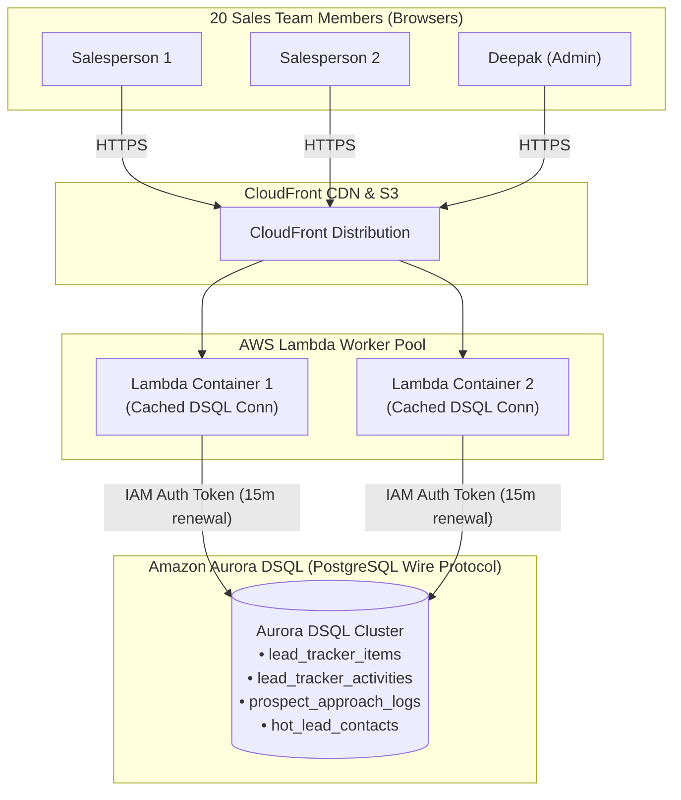

# Amazon Aurora DSQL Architecture & Multi-User Scaling Design

**Date:** 2026-11-27  
**Author:** Antigravity & Deepak Naidu  
**Status:** Approved  
**Scope:** 20 Concurrent Users (JFLL Sales Team, Coordinators, and Leadership)  

---

## 1. Problem Statement & Root Cause

In the current deployment, sales coordinators and sales representatives work in isolated silos where activity logs entered by one user are invisible to others (including Admin Deepak). 

### Root Causes
1. **RBAC Rejection & Silent Fallback:** In `lead_tracker_routes.py`, `require_lead_tracker_auth` strictly allows only `TRACKER_ADMIN_EMAILS` (`deepak@jfll.com`, `tyra.theknath@jfll.com`) and admin roles. When non-admin sales reps submit logs, the API returns `403 Forbidden`. The frontend in `leadTrackerService.ts` catches this error and silently saves the log into the user's browser `localStorage`. The log never reaches the server.
2. **Serverless Ephemeral Disk Isolation:** On AWS Lambda, each container has an isolated `/tmp` disk. SQLite databases (`lead_tracker.db`) and JSON logs (`approach_logs.json`) written on Container 1 do not exist on Container 2.
3. **S3 Overwrite Race Conditions:** Syncing whole database files to AWS S3 via `VACUUM INTO` results in last-write-wins collisions, silently discarding concurrent updates.

---

## 2. Proposed Architecture: AWS Lambda + Amazon Aurora DSQL

Amazon Aurora DSQL (Distributed SQL) provides a serverless, active-active, PostgreSQL-compatible distributed relational database.



### Key Architectural Benefits
- **No VPC / NAT Gateway Needed:** Aurora DSQL connects over standard TLS on port 5432 with IAM authentication. Lambda functions do not need to be in a VPC, saving ~$32/month on AWS NAT Gateways.
- **Permanent Free Tier for 20 Users:** 100,000 DPUs and 1 GB-month storage free every month forever. Estimated monthly cost for 20 users is **$0.00 to $1.50**.
- **Instant Global Consistency:** Eliminates local `/tmp` split-brain. A write from any sales rep is immediately visible to Deepak and the team.
- **Local Dev / Offline Parity:** When `DSQL_ENDPOINT` is not configured (e.g. running unit tests or offline on Mac), the system automatically uses an embedded SQLite/in-memory adapter, ensuring tests run in 1.4s with zero external dependencies.

---

## 3. Relational Schema Specification

### 3.1 `lead_tracker_items` (CRM Tracked Leads)
```sql
CREATE TABLE IF NOT EXISTS lead_tracker_items (
    id VARCHAR(64) PRIMARY KEY,
    company_name VARCHAR(255) NOT NULL,
    contact_person VARCHAR(255),
    contact_phone VARCHAR(64),
    contact_email VARCHAR(255),
    branch VARCHAR(100) NOT NULL,
    assigned_to VARCHAR(150) NOT NULL,
    assigned_to_email VARCHAR(255),
    assigned_by VARCHAR(150) DEFAULT 'Tyra Theknath',
    assigned_date DATE NOT NULL DEFAULT CURRENT_DATE,
    status VARCHAR(64) NOT NULL,
    transport_mode VARCHAR(64) NOT NULL,
    routing_type VARCHAR(64) NOT NULL,
    feedback_notes TEXT,
    next_followup_date DATE,
    next_action VARCHAR(255),
    quote_date DATE,
    rate_validity_date DATE,
    rate_validity_days INT DEFAULT 14,
    target_shipment_date DATE,
    linked_entity_type VARCHAR(64) DEFAULT 'custom',
    linked_entity_id VARCHAR(128),
    created_at TIMESTAMPTZ NOT NULL DEFAULT CURRENT_TIMESTAMP,
    updated_at TIMESTAMPTZ NOT NULL DEFAULT CURRENT_TIMESTAMP,
    created_by VARCHAR(150) DEFAULT 'Tyra Theknath',
    is_archived BOOLEAN NOT NULL DEFAULT FALSE
);
```

### 3.2 `lead_tracker_activities` (Audit & Interaction Timeline)
```sql
CREATE TABLE IF NOT EXISTS lead_tracker_activities (
    id VARCHAR(64) PRIMARY KEY,
    lead_id VARCHAR(64) NOT NULL REFERENCES lead_tracker_items(id) ON DELETE CASCADE,
    timestamp TIMESTAMPTZ NOT NULL DEFAULT CURRENT_TIMESTAMP,
    author_name VARCHAR(150) NOT NULL,
    author_email VARCHAR(255) NOT NULL,
    action VARCHAR(100) NOT NULL,
    old_status VARCHAR(64),
    new_status VARCHAR(64),
    notes TEXT
);
```

### 3.3 `prospect_approach_logs` (Outreach Logs)
```sql
CREATE TABLE IF NOT EXISTS prospect_approach_logs (
    id VARCHAR(64) PRIMARY KEY,
    entity_type VARCHAR(32) NOT NULL,
    entity_id VARCHAR(128) NOT NULL,
    company_name VARCHAR(255),
    action VARCHAR(64) NOT NULL,
    status VARCHAR(64) NOT NULL,
    note TEXT,
    logged_by VARCHAR(150) NOT NULL,
    logged_by_email VARCHAR(255) NOT NULL,
    created_at TIMESTAMPTZ NOT NULL DEFAULT CURRENT_TIMESTAMP
);
```

### 3.4 `hot_lead_contacts` (Coordinator Enriched Contacts)
```sql
CREATE TABLE IF NOT EXISTS hot_lead_contacts (
    sr_no INT PRIMARY KEY,
    customer_name VARCHAR(255),
    gstin VARCHAR(32),
    phone VARCHAR(64),
    contact_person VARCHAR(255),
    email VARCHAR(255),
    notes TEXT,
    updated_at TIMESTAMPTZ NOT NULL DEFAULT CURRENT_TIMESTAMP,
    updated_by VARCHAR(150)
);
```

---

## 4. RBAC & Access Control Model

| Operation | Sales Representative | Sales Coordinator | Leadership / Admin |
| :--- | :---: | :---: | :---: |
| **View Leads & Timelines** | ✅ All Leads | ✅ All Leads | ✅ All Leads |
| **Log Activity / Touchpoint** | ✅ Assigned Leads | ✅ Any Lead | ✅ Any Lead |
| **Update Stage & Notes** | ✅ Assigned Leads | ✅ Any Lead | ✅ Any Lead |
| **Reassign Sales Rep** | ❌ Forbidden | ✅ Allowed | ✅ Allowed |
| **Archive / Delete Lead** | ❌ Forbidden | ❌ Forbidden | ✅ Allowed |
| **Enrich Hot Lead Contact** | ✅ Allowed | ✅ Allowed | ✅ Allowed |

- **Audit Attribution:** Every activity log extracts `author_name` and `author_email` directly from verified JWT claims (`user["sub"]`, `user["name"]`). Standard sales reps cannot spoof author attribution.

---

## 5. Frontend Resilience & Error Transparency
1. **No Silent Swallowing:** Remove silent fallbacks on `403 Forbidden` and `5xx` errors. If the server rejects an action, surface a clear banner/notification.
2. **Auto-Polling & Cache Invalidation:** Configure TanStack Query / polling interval (e.g. 15s) so when a teammate logs an activity, all dashboards update automatically.
